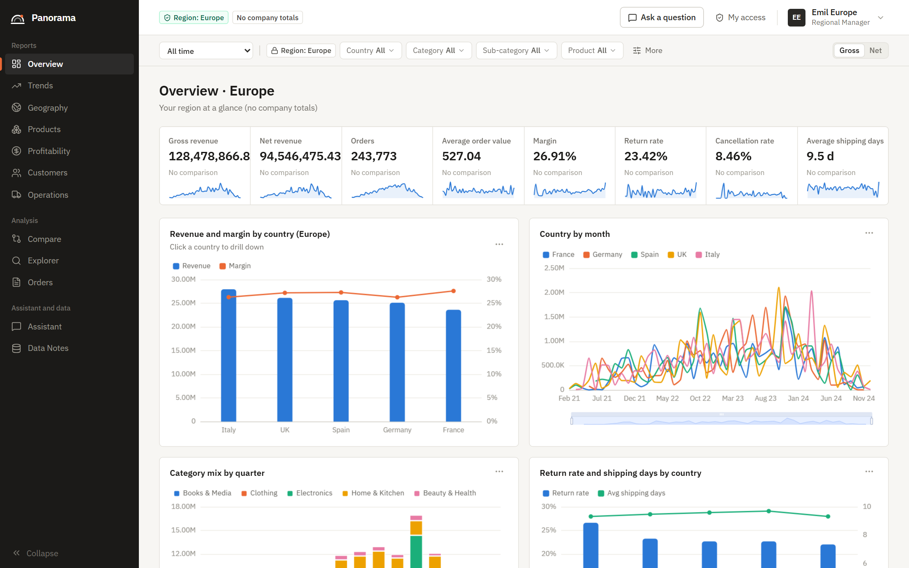
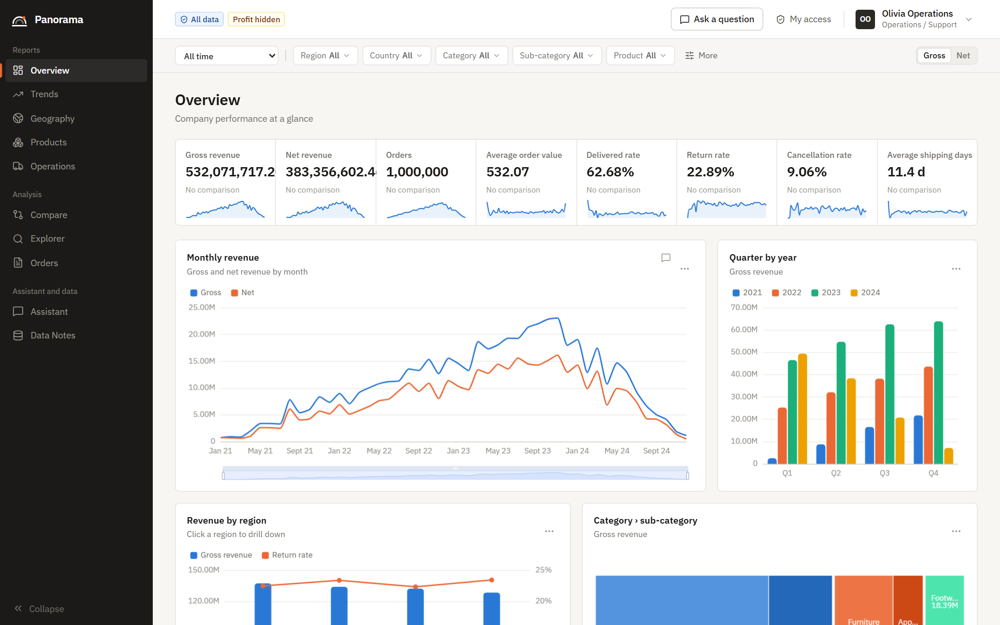
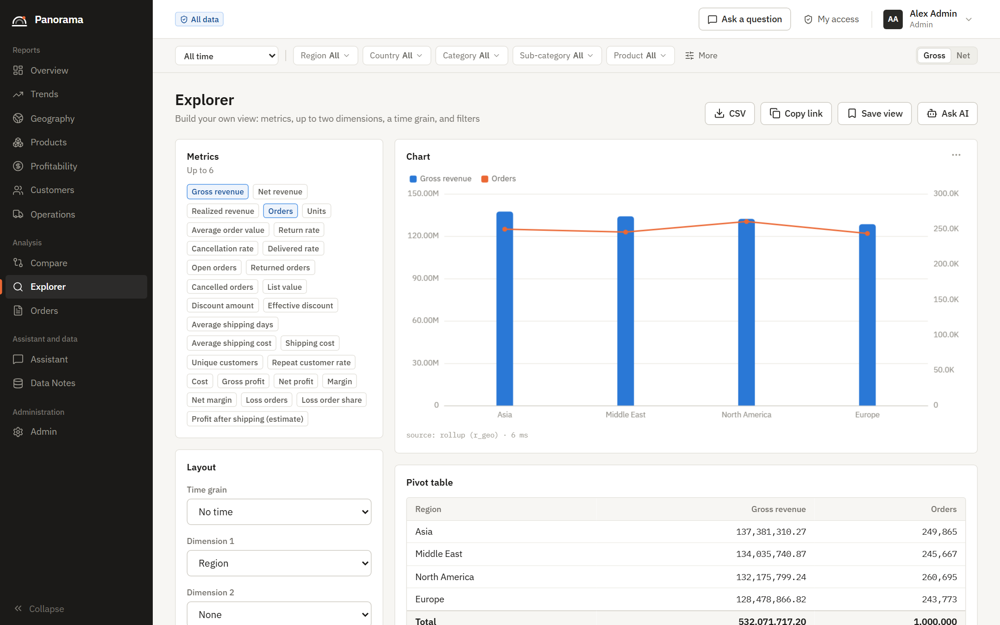
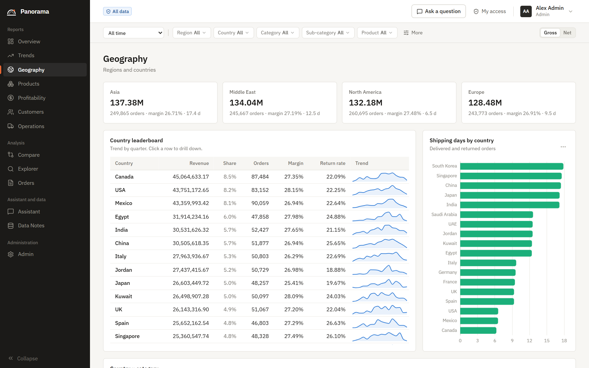
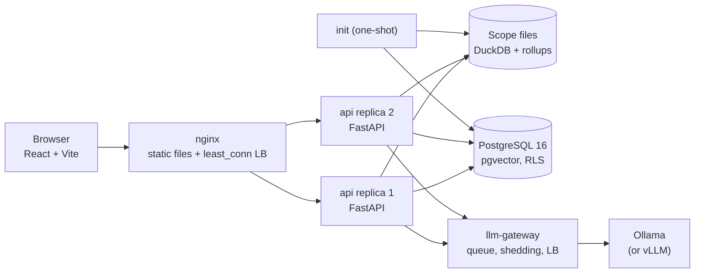

<h1 align="center">RagSheet</h1>

<p align="center">
  <b>Sales analytics with an AI assistant that does not make up numbers.</b><br/>
  Dashboards, RAG chat with a local LLM, and role-based access that the server enforces in two layers.
</p>

<p align="center">
  
  
  
  
  
  
  
</p>


<sub>The screenshots show the generated dataset with 1,000,000 orders. The app was first named "Panorama", and the UI still shows that name.</sub>

## What it is

RagSheet is a sales reporting and analytics application for the e-commerce dataset `Test_sales_dataset(ecommerce_sales_dataset).csv` (10,000 orders, 2021-01 to 2024-12). It has:

- **Dashboards** for 11 pages: Overview, Trends, Geography, Products, Profitability, Customers, Operations, Compare, Explorer, Orders, and Data Notes. All pages have filters, drill-down, comparisons, tables, and CSV export.
- **An AI assistant** with RAG and a local LLM (Ollama, `qwen3:4b-instruct-2507` by default). Code calculates every number. The LLM only plans the query and writes the text, and a grounding check compares the text with the result tables.
- **Six roles with role-based access to data.** The server enforces each rule in two independent layers (the application and the PostgreSQL database).
- **Scale features that are built and measured:** 1,000,000 generated orders, api replicas behind an nginx load balancer, and an LLM gateway with a fair queue, load shedding, and a load balancer over LLM endpoints.

Everything runs on the local computer with Docker Compose. No paid API is necessary.

## Key results

| Area | Result |
|---|---|
| Numbers in the AI answers | 100 % correct in the result tables on 53 gold questions. The grounding check replaces AI text that has a wrong number. |
| Data access | 0 data leaks and 100 % refusal recall in the evaluation. Row-level security in PostgreSQL is a second layer behind the application checks. |
| Load | 500 users on 1,000,000 orders: 0 failed requests of 66,870, dashboard p95 150–270 ms (3 api replicas, one laptop). |
| Graceful degradation | When the GPU is busy, the user gets the correct table at once, with an "AI busy" notice, not an error. |

See [Measured capacity](#measured-capacity) for the full results and the test conditions.

## Screenshots

**Each role sees only its own data.** A regional manager sees only Europe and no company totals. The operations role sees no cost, profit, or margin.

| Regional manager (Europe) | Operations (profit hidden) |
|---|---|
|  |  |

| Explorer: any metric, dimension, and filter | Geography: region and country drill-down |
|---|---|
|  |  |

## Contents

1. [Quick start](#quick-start)
2. [Demo users and role guide](#demo-users-and-role-guide)
3. [Pages](#pages)
4. [The AI assistant](#the-ai-assistant)
5. [Metric definitions](#metric-definitions)
6. [Data notes](#data-notes)
7. [Run modes](#run-modes)
8. [Architecture](#architecture)
9. [Measured capacity](#measured-capacity)
10. [Tests and scripts](#tests-and-scripts)
11. [Troubleshooting](#troubleshooting)
12. [Project layout](#project-layout)

## Quick start

**You need:**
- Windows 10/11, macOS, or Linux with Docker Desktop (Compose v2). Docker must have at least 8 GB of memory.
- Recommended: an NVIDIA GPU with 6 GB VRAM or more (the AI text is much faster). Without a GPU, use the CPU mode (see [Run modes](#run-modes)).
- Approximately 10 GB of free disk space (images, the 2.5 GB model, and the data).

**Steps:**
1. Start Docker Desktop.
2. Optional (Windows): run `.\scripts\check_env.ps1`. It checks Docker, the GPU, port 8080, the disk, and the settings.
3. Start the stack:

   ```bash
   docker compose up -d --build
   ```

4. Open http://localhost:8080.
5. Click a demo user card, and then click **Sign in**. The password for all demo users is `Demo@2024`.

The first start takes a few minutes. The `init` service creates the secrets, the database, the star schema, the 12 scope files, and the RAG corpus. The dashboards work as soon as the api is healthy. The model download (2.5 GB) continues in the background. Until it is complete, the AI assistant gives basic answers (correct tables with template text) and shows the download progress.

To stop: `docker compose down`. To delete all data (database, secrets, model): `docker compose down -v`.

## Demo users and role guide

| User | Role | Rows | Cost, profit, margin | Customer ID | Pages | Landing page |
|---|---|---|---|---|---|---|
| `admin` | Admin | All | Yes | Real | All + Admin | Overview |
| `exec` | Executive | All | Yes | Real | All | Overview |
| `rm.namerica`, `rm.europe`, `rm.asia`, `rm.mideast` | Regional Manager | Own region only | Yes | Real | All | Overview |
| `cm.electronics`, `cm.clothing`, `cm.home`, `cm.books`, `cm.beauty` | Category Manager | Own category only | Yes | Real | All | Overview |
| `analyst` | Sales Analyst | All | Yes | Pseudonym `C-…` | All | Explorer |
| `ops` | Operations / Support | All | **No** | Real | All except Profitability and Customers | Operations |

**Rules for all roles:**
- The server enforces all rules. The UI only hides items for usability.
- Regional and Category Managers do not see company totals or benchmarks of other scopes, because a subtraction could show other data.
- A filter value outside the scope gives `403 OUT_OF_SCOPE`, and the audit log records it. An order outside the scope gives `404`.
- An unknown role, or a manager without a region or category, gets `403`. The system never falls back to "all data".
- After 5 failed sign-ins, the account is locked for 5 minutes.

**Two security layers:**
1. **Application:** `build_scope(user)` makes the row filters, the allowed columns, and the PII mode. Each scope has its own DuckDB file that contains only the rows and columns of that scope (the `ops` file has no financial columns; the `analyst` file has only pseudonyms).
2. **Database:** PostgreSQL calculates the scope key from the `app.users` row independently. If the two keys are not equal, the request fails closed. Row-level security (RLS) protects the RAG documents and the chat history. The app role has no `SELECT` on the sales tables; it reads sales rows only through a view that applies the scope.

The admin can create users, change roles and scopes, deactivate users, and reset passwords (**Admin → Users**). A role change makes the old sessions of that user invalid at once.

## Pages

| Page | What it shows |
|---|---|
| Overview | KPI cards (gross, net, and realized revenue, orders, AOV, margin, return and cancellation rates), monthly trend, top regions, categories and products, insights. The layout changes for regional and category managers. |
| Trends | Revenue, orders, and margin by month, quarter, or year; seasonality; same period last year. |
| Geography | Region → country charts, a category × country heat map, shipping days by country, with drill-down. |
| Products | Category → sub-category → product, discount and price bands. |
| Profitability | Margin, loss orders (losses start at a 40 % discount), profit after shipping (estimate). Not for `ops`. |
| Customers | Segments, gender, repeat customers, top customers. Not for `ops`. The analyst sees pseudonyms. |
| Operations | Order status, shipping methods and days, payment methods, open orders. No financial widgets. |
| Compare | Two periods or two values side by side, with deltas. |
| Explorer | Any metric × any dimension × any filter. Shows the source of each result (rollup or raw). |
| Orders | Server-paged order table (keyset paging; works at 1M rows), search, order detail drawer, CSV export (max 10,000 rows, audited). |
| Data Notes | The data quality problems of the dataset (see [Data notes](#data-notes)) and the metric glossary. |
| Admin | Users, audit log, role matrix, system (replicas, scope files, model, GPU, queue, database), AI quality (eval report, feedback). |

The **Gross / Net** switch on the pages changes the revenue basis. Filters are in the URL, so you can share a view. A grey value has a sample size below 30.

## The AI assistant

Open the assistant from the top bar (drawer) or from the **Assistant** page. It answers questions about the data in your scope, for example:

- "What was the gross revenue in 2023?"
- "Electronics revenue in Q3 2023" (as `rm.asia`: 108,012.34)
- "Why did revenue drop in 2024?"
- "Is overnight shipping faster than economy?"
- "Which discount levels lose money?"

**How one turn works:**
1. A guard checks the question for injection attempts and for metrics that the role cannot see (for example "margin" for `ops`). These get a refusal with 0 LLM calls.
2. A rule parser turns most questions into a query plan without the LLM. If the rules are not sure, the LLM writes the plan (JSON), and the policy checks it.
3. The analytics engine runs the plan on the scope file of the user. Retrieval (PostgreSQL full text + pgvector, with RLS) adds the definitions, data notes, and insights that apply.
4. The answer appears in one of these modes:

| Mode | When | LLM calls |
|---|---|---|
| `template` | Simple questions (one metric, a breakdown, a definition, an order lookup) | 0 |
| `ai` | "Why", compare, trend, and open questions: the LLM writes the text from the result tables | 1–2 |
| `ai_replaced` | The grounding check found a wrong number in the AI text; the template text replaces it | 1–2 |
| `basic` | The AI is busy (queue wait > 20 s), still downloading, or stopped: the correct table at once, with a notice | 0 |
| `refusal` | Out-of-scope data, hidden metrics, or injection attempts | 0 |

Each answer shows the steps, the queue position, the plan, the result tables with citations (`[R1]`, `[S1]`), and the sources. **Explain** asks the AI to explain a template answer.

## Metric definitions

The metric registry (`backend/app/analytics/metrics.py`) is the single source of truth for the dashboards, the exports, the chat, and the glossary.

| Metric | Definition | Sensitivity |
|---|---|---|
| Gross revenue | SUM(revenue), all statuses. "Revenue" and "sales" mean this metric. | Public |
| Net revenue | SUM(revenue) where the status is not Cancelled and not Returned | Public |
| Realized revenue | SUM(revenue) where the status is Delivered | Public |
| Orders, units, AOV | COUNT(orders), SUM(quantity), gross revenue / orders | Public |
| Return rate | Returned / (Delivered + Returned) | Public |
| Cancellation rate | Cancelled / all orders | Public |
| Effective discount | Discount amount / list value | Public |
| Average shipping days | AVG(shipping days) of Delivered and Returned orders | Public |
| Average shipping cost, shipping cost | Shipping cost / orders, SUM(shipping cost) | Public |
| Unique customers, repeat customer rate | COUNT DISTINCT customer; share of customers with 2+ orders | Public |
| Cost, gross profit, net profit | SUM | Financial |
| Margin, net margin | SUM(profit) / SUM(revenue) × 100 (weighted, not the mean of the margin column) | Financial |
| Loss order share, profit after shipping | Share of orders with profit < 0; profit − shipping cost (estimate) | Financial |

**Reference values (sample dataset):** gross revenue 5,284,387.70; net revenue 3,845,611.08; realized revenue 3,308,169.75; gross profit 1,437,638.31; margin 27.21 %; return rate 22.84 %; cancellation rate 9.08 %; AOV 528.44.

"Today" in the app is the last date in the data (2024-12-24 for the sample). "Same period last year" uses like-for-like dates.

## Data notes

The **Data Notes** page shows these facts about the dataset. The AI assistant uses them too.

1. One customer ID can have a different segment, gender, and country on different orders. The app uses these values "at order time".
2. Shipping days do not change with the shipping method. The region controls the delivery time. Overnight costs approximately 12 times more than Economy.
3. Profit does not include the shipping cost.
4. The mean of the `Profit_Margin_%` column (23.6 %) is not the weighted margin (27.21 %). The app always uses the weighted margin.
5. 93 orders from 2021 still have the status "Processing". The status is a snapshot.
6. Revenue includes cancelled and returned orders. Thus the app shows gross, net, and realized revenue.
7. The volume increases in 2021, is stable in 2023, and decreases through 2024 (12 orders in December 2024). The app shows a caveat for periods that touch these months.

## Run modes

Put the lines in `.env` (see `.env.example` for all settings), then run `docker compose up -d`.

**Switch between Ollama and vLLM with one command.** Double-click `switch-llm.cmd` in the project folder, or run:

```bash
powershell -File scripts/llm.ps1
```

The command changes to the other server. It stops the old server, changes only the LLM lines in `.env`, starts the new server, and waits until the AI is ready. Measured: to vLLM 65 s, back to Ollama 8 s. Other forms: `scripts/llm.ps1 -Use vllm`, `-Use ollama`, and `-Use status` (shows the current server). Your own Ollama model choice (for example `qwen3:8b`) comes back when you switch back.

| Mode | Settings | Notes |
|---|---|---|
| Default | (none) | Sample data, 2 api replicas, `qwen3:4b-instruct-2507` with 4 parallel slots on the NVIDIA GPU |
| Large data | `DATASET=1m` | The first start generates and loads 1,000,000 orders (approximately 2–3 minutes). The UI, roles, and chat stay the same. |
| More replicas | `API_REPLICAS=3` | Keep `API_REPLICAS × API_WORKERS × 10 ≤ 70`. |
| Quality mode | `LLM_MODEL=qwen3:8b`, `LLM_PARALLEL=1`, `LLM_TURN_ESTIMATE_S=18` | Longer AI text, 2–3 times slower, 1 slot |
| CPU only (no NVIDIA GPU) | `COMPOSE_FILE=docker-compose.yml`, `LLM_PARALLEL=1`, `LLM_NUM_THREAD=6`, `LLM_TURN_ESTIMATE_S=45`, `LLM_MAX_WAIT_S=60` | The AI is slow; template and basic answers stay fast. |
| vLLM | `COMPOSE_PROFILES=vllm`, `LLM_PROVIDER=openai_compatible`, `LLM_ENDPOINT=http://vllm:8000/v1`, `LLM_MODEL=Qwen/Qwen3-4B-AWQ`, `LLM_PARALLEL=8` | OpenAI-compatible server for high concurrency. Stop Ollama first (`docker compose stop ollama`): use one LLM server at a time on a 6 GB GPU. The first start downloads the image (31 GB on disk) and the model (2.5 GB). `VLLM_GPU_UTIL` (default 0.75) sets its share of the GPU memory. |
| Ollama on the host | `COMPOSE_PROFILES=`, `LLM_ENDPOINT=http://host.docker.internal:11434` | Uses an Ollama that is installed on the computer. |
| Several LLM servers | `LLM_ENDPOINTS=[{...},{...}]` | The gateway balances the turns over the endpoints. |

## Architecture



| Service | Job |
|---|---|
| `secrets` | Makes the secrets one time (JWT key, database passwords, PII HMAC key) in Docker volumes. |
| `postgres` | PostgreSQL 16 + pgvector: star schema (`sales`), users, audit, chat (`app`), RAG documents (`rag`). |
| `init` | Roles, migrations, data load and checks, scope files, demo users, RAG corpus. It skips each step that is already done. |
| `api` (× `API_REPLICAS`) | FastAPI. Stateless: any replica accepts any token. |
| `frontend` | nginx: the React app and the load balancer (`least_conn`, passive health checks, retry of idempotent requests). |
| `llm-gateway` | One global FIFO queue, slots, per-user limits, deadline and load shedding, LLM load balancer with a breaker for each endpoint, model download. |
| `ollama` | The local LLM server (GPU). |

**Large-data engine:** `init` exports the rows of each of the 12 scopes into its own read-only DuckDB file with rollup tables (month × region × category × …). The aggregate navigator uses a rollup when it gives the same result as the raw rows (additive metrics, no day-level filters), else the raw rows. A test checks the equality for every spec in a grid. PostgreSQL load does not grow with the data size.

**Concurrency:** the database calls run in threads, so a slow query never stops the chat streams. Writes are short transactions with one retry. Dashboard audit events are buffered and written each second. Each chat user has one turn at a time; the gateway gives each new turn a queue position, and after `LLM_MAX_WAIT_S` the user gets the correct table without AI text.

## Measured capacity

All values were measured on one laptop: Intel i7-12700H (6 performance + 8 efficiency cores), 16 GB RAM (Docker: 8 GB), RTX 3060 Laptop GPU (6 GB). Each api replica has a limit of 2 CPUs. Reports: `loadtest/reports/` (`python loadtest/summarize.py <prefix>` gives the steady-state values without the sign-in phase) and `backend/eval/reports/`.

### AI quality (53 gold questions, `scripts/run_eval.ps1`)

| Model | All gates | Numbers in result tables | Numbers in AI text | AI answers p50 / p95 | Template answers p95 |
|---|---|---|---|---|---|
| `qwen3:4b-instruct-2507` × 4 slots (default) | pass | 100 % | 98.8 % | 2.7 s / 7.4 s | 0.06 s |
| `qwen3:8b` × 1 slot | pass | 100 % | 100 % | 6.3 s / 13.2 s | 0.05 s |
| Numeric eval at 1M rows (4B) | pass | 100 % | — | — | 0.09 s |
| vLLM `Qwen/Qwen3-4B-AWQ` × 8 slots (profile `vllm`) | pass | 100 % | 100 % | 2.3 s / 4.7 s | 0.04 s |

The 4B model is the default: it is 2–3 times faster and has 4 parallel slots. 0 leaks and 100 % refusal recall for both models. The grounding check replaced 1 of 14 AI texts of the 4B model with the template text (the numbers were then correct).

### Load test B: chat capacity (sample data, chat users only, 90 s for each step)

New AI answers each minute and AI answer time (p50 / p95). The question mix also contains template questions, and each user is limited to 30 turns each minute (HTTP 429 above the limit).

| Chat users | Ollama `qwen3:4b-instruct-2507` × 4 slots | vLLM `Qwen3-4B-AWQ` × 8 slots |
|---|---|---|
| 1 | 4.7 / min, 3.2 s / 4.7 s | 4.0 / min, 2.5 s / 3.0 s |
| 4 | 9.3 / min, 3.1 s / 6.1 s | 10.7 / min, 3.2 s / 4.3 s |
| 8 | 16.7 / min, 8.4 s / 14 s | 21.3 / min, 3.6 s / 5.2 s |
| 16 | 11.3 / min, 27 s / 39 s (queue; 4 answers shed) | 28.7 / min, 6.3 s / 11 s (no shed) |

vLLM gives about 2.5 times more AI answers at 16 chat users, but it needs a 31 GB image and the GPU for itself. Ollama stays the default because it is small and simple to start. With vLLM, the grounding check replaced 15 of 108 AI texts with the template text (Ollama: 0 in this test); the numbers in the answers stayed correct.

### Load test R: replica scaling (1M rows, dashboards only, Ollama stopped)

| API replicas | Saturation throughput | Failed requests |
|---|---|---|
| 1 | 156 requests/s | 0 |
| 2 | 222 requests/s (1.43 ×) | 0 |
| 3 | 262 requests/s (1.68 ×) | 0 |

- One replica was stopped for 30 s during the 3-replica run (160 users): 1 of 14,378 requests failed (a POST that was open on the stopped replica; nginx retries only GET requests). No GET request failed, and the throughput did not drop.
- The scaling is less than linear. Each replica uses its full 2 CPUs, and Locust uses less than 0.5 CPU. The laptop CPU has hyperthreads and slower efficiency cores, and the WSL 2 VM does not place threads by core type. So two busy replicas get less work done for each CPU than one. The gate "2 replicas ≥ 1.6 × 1 replica" **fails on this computer** (1.43 ×).
- The M11 optimizations increased the throughput by about 40 % (before: 110 / 160 / 223 requests/s): the principal read in one statement, date-window order paging, and a larger connection pool.

### Load test C: mixed load on the sample data (200 users, 2 replicas)

70 % dashboard users (2–6 s wait), 30 % chat users (5–15 s wait), 6 minutes. 23,016 requests, **0 failures**, 0 scope violations, 0 answers with 409 or 429.

| Request type | p50 | p95 | p99 |
|---|---|---|---|
| Dashboards (KPIs, batch, Explorer, orders, insights) | 8–25 ms | 23–83 ms | 59–180 ms |
| Chat: template answers | 43 ms | 220 ms | — |
| Chat: cached answers | 100 ms | 340 ms | — |
| Chat: new AI answers (includes the queue for 4 GPU slots) | 17 s | 35 s | — |

Requests per replica: 10,629 and 10,286 (within ±2 % of the mean). `db.write` p95: about 20 ms. PostgreSQL connections: 17.

### Load test L: mixed load on 1M rows (500 users)

80 % dashboard users, 20 % chat users, 2 minutes ramp, 5 minutes steady.

| | 2 replicas (default) | 3 replicas |
|---|---|---|
| Throughput (steady) | 171 requests/s (api CPU saturated) | 179 requests/s (api CPU 50–80 %) |
| Failed requests | 6 of 61,660 (502, see below) | **0 of 66,870** |
| Dashboards p50 / p95 / p99 | 70–110 ms / 1.3–1.7 s / 3.1 s | 14–30 ms / 150–270 ms / 600–800 ms |
| Chat template answers p95 | 3.4 s | 710 ms |
| `db.write` p95 | 170 ms | 60 ms |
| PostgreSQL connections | 17 | 25 |
| Result cache hit rate | 97 % | 96 % |

- **For 500 users at 1M rows, use `API_REPLICAS=3`.** With 3 replicas, all dashboard and chat latency gates pass. The gate `db.write` p95 ≤ 20 ms fails (60 ms): all containers share the same CPU.
- The six 502 answers in the 2-replica run came from a keep-alive race between nginx and uvicorn. The fix (`--timeout-keep-alive 75`) was in place for the 3-replica run.
- New AI answers: about 10 each minute with `qwen3:4b-instruct-2507` × 4 slots under this load. The other chat turns got a template answer, a cached answer, or the correct table with the "AI busy" notice (`basic_shed`) after 20 s in the queue.

### What limits the capacity

- **The GPU limits the AI text**, not the software. The queue, the load shedding, the template answers, and the caches keep the numbers fast for all users. More AI answers need more GPU slots or more endpoints.
- **The CPU limits the dashboards.** One api replica serves about 140–160 dashboard requests each second at 1M rows. Add replicas until the CPU of the computer is full.
- Each sign-in uses bcrypt (about 0.25 s of CPU). Many sign-ins at the same moment slow the other requests for a short time.

## Tests and scripts

| Command | What it does |
|---|---|
| `docker compose --profile test run --rm tests` | Backend tests (pytest, ~255 tests, ~2.5 min, no GPU): security, RBAC matrix, database security, scope files, navigator equality, golden numbers, metrics vs. a pandas oracle, chat injection, concurrency, gateway balancing. |
| `cd frontend; npm test` | Frontend unit tests (Vitest). |
| `cd frontend; npx playwright install chromium; npm run e2e` | Browser smoke test for each demo user against the running stack. |
| `.\scripts\smoke.ps1` | API smoke test for each role through the load balancer. |
| `.\scripts\run_eval.ps1` | AI evaluation: 53 gold questions against the running stack; reports in `backend/eval/reports/` (also on **Admin → AI quality**). |
| `.\scripts\loadtest.ps1 -Scenario R\|C\|L\|B` | Load tests with Locust; reports in `loadtest/reports/`. |
| `.\scripts\boot_test.ps1` | Clean-start test: removes the state volumes, starts 2 replicas, checks one load and one build of each kind, the same pseudonym on both replicas, the smoke test, and that a second start skips all builds. |
| `.\scripts\llm.ps1` (or double-click `switch-llm.cmd`) | Switches the chat LLM server between Ollama and vLLM. `-Use status` shows the current server. |
| `.\scripts\check_env.ps1` | Checks the computer before the first start. |
| `.\scripts\psql.ps1` | Opens `psql` in the database container. |
| `.\scripts\backup.ps1`, `.\scripts\restore.ps1` | Backup and restore of the database (`pg_dump` / `pg_restore`). The scope files are built again from the database. |

## Troubleshooting

| Problem | What to do |
|---|---|
| The assistant says "The AI model is downloading" | Wait. **Admin → System** shows the progress. Dashboards and basic answers work during the download. |
| The assistant says "AI busy" | The queue was full or the wait was more than `LLM_MAX_WAIT_S`. The table is correct. Ask again later, or use more slots or more endpoints. |
| No GPU in Docker (`could not select device driver`) | Install the current NVIDIA driver and enable WSL 2 GPU support, or use the CPU mode. |
| Port 8080 is in use | Stop the other program, or change the port in `docker-compose.yml` (`frontend.ports`). |
| `init` fails | `docker compose logs init` shows the check that failed (for example a changed CSV). |
| Load test L fails with out-of-memory errors | Give WSL 2 more memory: `memory=12GB` in `%UserProfile%\.wslconfig`, then `wsl --shutdown`. |
| A locked account | Wait 5 minutes, or an admin resets the password. |

## Project layout

```
backend/            FastAPI app (app/), migrations, tests, eval (gold questions, pandas oracle, reports)
  app/analytics/    metric registry, compiler, aggregate navigator, DuckDB engine, periods, insights
  app/chat/         guard, entities, rule parser, planner, policy, tools, grounding, pipeline (SSE)
  app/data/         loader, generator (1M rows), scope-file store, vocabulary, synonyms
  app/gateway/      LLM gateway: admission, balancer, breakers, providers (Ollama, OpenAI-compatible)
  app/rag/          corpus builder, embedder, retriever (full text + pgvector, RLS)
  app/security/     policy (build_scope), passwords, tokens, lockout
frontend/           React + Vite + TypeScript, nginx config, Playwright e2e
loadtest/           Locust file and reports
scripts/            PowerShell helper scripts
assets/screenshots/ README images
```
